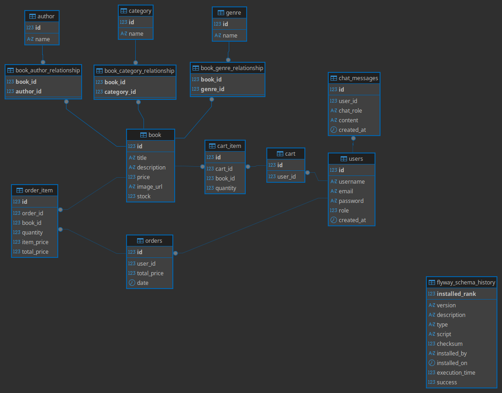

# Aurora Bookstore — Curated Literary E-Commerce Powered by Local AI

Aurora Bookstore is a literary e-commerce system designed to showcase the integration of Local Artificial Intelligence within modern corporate applications. The project implements advanced software engineering techniques, combining Java (Spring Boot) and React with local LLM orchestration, Retrieval-Augmented Generation (RAG), dynamic function calling, and vector semantics.

---

## Key Features

- **Local AI Integration (Boreal Assistant):** An interactive chatbot companion that streams real-time responses using Server-Sent Events (SSE). It performs semantic searches over bookstore policies and leverages dynamic tool calling to retrieve catalog metadata (books, genres, authors).
- **Dynamic Catalog Creation (Admin-Only):** Admin accounts can publish new books, upload cover images physically to the server, and create taxonomy items (authors, categories, genres) on the fly directly from the publishing interface.
- **Robust Role Security:** JSON Web Token (JWT) session-based authorization secured at the controller level with `@EnableMethodSecurity` and `@PreAuthorize`.
- **Advanced Context Management:** Safe multi-threaded servlet context propagation to support asynchronous processing on reactive streams.
- **Contextual Semantic Search:** Unified search bar filtering books and authors dynamically based on keywords and routes.
- **100% Portability:** Path resolutions and container configurations designed to compile and run on any machine immediately.

---

## Architecture & Database Model

The relational model handles users, shopping carts, orders, chat messages, and many-to-many catalog relationships.

Here is the database model generated for the application:



---

## Technology Stack

### Backend
- **Java 21**
- **Spring Boot 4.1.0** (Web, Security, Data JPA)
- **Spring AI 2.0.0** (LLM orchestrator & RAG pipelines)
- **Hibernate / JPA** (Object-Relational mapping)
- **Flyway Migrations** (Schema versioning)
- **JWT (Java JWT)** (Token creation and verification)
- **Maven** (Dependency manager)

### Frontend
- **React 19**
- **Vite** (Dev server & asset compiler)
- **Tailwind CSS v3** (Utility-first styling framework)
- **React Router v7** (SPA router)
- **Lucide Icons** (SVG vector icons)
- **Context API** (Global state management)

### Infrastructure & Vector search
- **MySQL 8.0** (Transactional database container)
- **ChromaDB** (Vector database for embeddings container)
- **Ollama** (Local LLM environment container)
- **H2 Database** (In-memory transactional database for automated testing)

---

## Dependencies & Requirements

To run this application, make sure your computer has the following tools installed:

1.  **Docker & Docker Compose** (to spin up MySQL and ChromaDB databases)
2.  **Node.js (v18+) & npm** (to run the React frontend)
3.  **Java 21 JDK** (to compile the Spring Boot backend)
4.  **Apache Maven (mvn)** (to manage Java dependencies)

---

## How to Get Started

### 1. Clone the Repository
```bash
git clone https://github.com/GRodrigues34/aurora-book-store.git
cd aurora-book-store
```

### 2. Quick Start (Run Everything in One Go)
We provide a unified script that clears container volumes, starts the databases, builds the project, and boots both frontend and backend:
```bash
chmod +x run.sh
./run.sh
```

### 3. Manual Component Execution
If you prefer to start and monitor the frontend and backend in separate terminals:

#### Running the Backend
The backend script spins up the Docker containers (MySQL & ChromaDB), builds the Maven package skipping tests, waits for the database ports to become active, and launches the Spring Boot application:
```bash
chmod +x runbackend.sh
./runbackend.sh
```

> **Note on AI Offline Simulation:** If you do not have a GPU/Ollama installed locally to run Llama 3.1, you can start the backend in simulation profile. This mocks the Boreal Chat answers using hardcoded reactive stream responses:
> ```bash
> chmod +x runchatsim.sh
> ./runchatsim.sh
> ```

#### Running the Frontend
Navigate to the frontend folder, install the npm modules, and start the Vite hot-reloading development server:
```bash
cd aurora-frontend
npm install
npm run dev
```

---

## Running the Automated Test Suite

There is **56 tests** (unit tests and integration tests) to validate cart mechanics, JWT token generation, role security, database operations, and cover image uploads:
```bash
chmod +x runtests.sh
./runtests.sh
```

---

## Access Credentials

Once the servers are running, open your browser and navigate to:
- **Frontend App:** `http://localhost:5173`
- **Swagger REST API Documentation:** `http://localhost:8080/swagger-ui.html`
- **H2 In-Memory DB Console (Tests):** `http://localhost:8080/h2-console` (JDBC URL: `jdbc:h2:mem:testdb`, User: `sa`, Password: *blank*)

### Login Accounts
- **Admin User (Can publish books/upload covers):**
  - **Email:** `testadmin@email.com`
  - **Password:** `test123`
- **Regular Customer (Can purchase and chat with AI):**
  - **Email:** `testuser@email.com`
  - **Password:** `test123`
